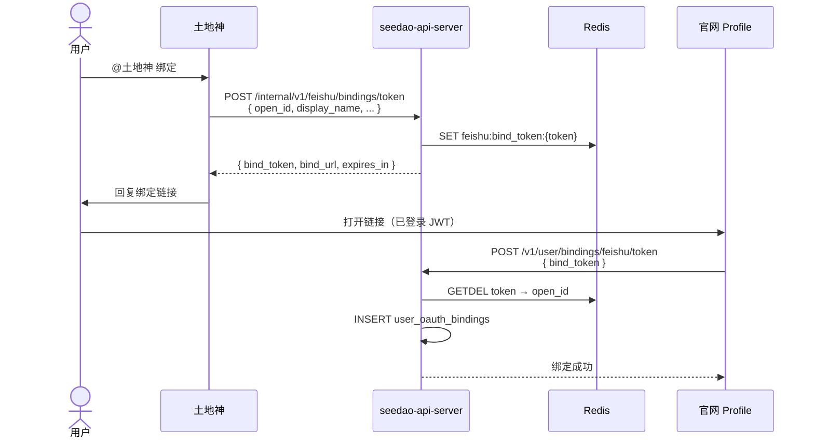
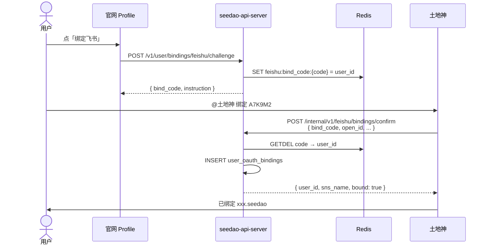
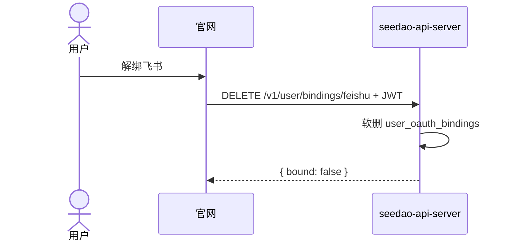
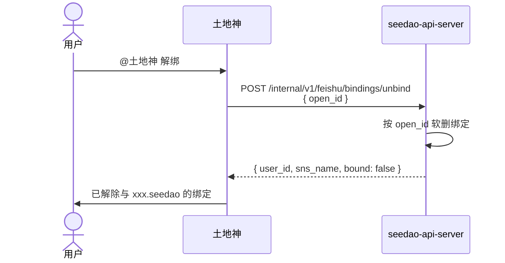

# 飞书账号绑定（土地神 Token 方案）

SeeDAO 会员与飞书 `open_id` 的绑定模块。不使用飞书 OAuth，通过**土地神机器人**与官网 Profile 协同完成绑定/解绑。

## 背景

- 会员来自不同飞书组织（租户），`user_id` 不可跨组织复用。
- 绑定主键使用土地神 App 下的 **`open_id`**（`ou_...`）。
- 身份锚点仍是 SeeDAO `user_id` + JWT；飞书为附加绑定。

## 数据表

表名：`user_oauth_bindings`

| 字段 | 说明 |
|------|------|
| `user_id` | SeeDAO 用户 |
| `provider` | 固定 `feishu` |
| `provider_app_id` | 土地神飞书 App ID |
| `open_id` | 飞书 open_id |
| `union_id` | 可选 |
| `display_name` | 飞书昵称快照 |
| `bind_source` | `bot_token` 或 `bot_code` |
| `deleted_at` | 软删（解绑） |

约束（活跃记录）：

- 一个 `user_id` 最多绑定一个飞书
- 一个 `open_id`（同 App）最多绑定一个 `user_id`

迁移文件：`src/migrations/010_user_oauth_bindings.sql`

## 接口清单

### 用户侧（JWT）

| 方法 | 路径 | 说明 |
|------|------|------|
| GET | `/v1/user/bindings` | 查询绑定状态 |
| POST | `/v1/user/bindings/feishu/token` | 路径 A：用 `bind_token` 完成绑定 |
| POST | `/v1/user/bindings/feishu/challenge` | 路径 B：生成 `bind_code` |
| DELETE | `/v1/user/bindings/feishu` | 解绑 |

### 土地神服务间（`X-Service-Token`）

| 方法 | 路径 | 说明 |
|------|------|------|
| POST | `/internal/v1/feishu/bindings/token` | 路径 A：用户 `@土地神 绑定` 时创建 `bind_token` |
| POST | `/internal/v1/feishu/bindings/confirm` | 路径 B：用户发送 `绑定 {code}` 时确认绑定 |
| GET | `/internal/v1/feishu/bindings` | 按 `open_id` 查询是否已绑定（及 SNS） |
| POST | `/internal/v1/feishu/bindings/unbind` | 用户 `@土地神 解绑` 时按 `open_id` 解绑 |
| GET | `/internal/v1/members` | 分页拉取注册会员列表（SNS / 注册时间 / 会员到期） |

配置项见 `config.*.yaml` 的 `feishu` 与 `internal.service_token`。

两条绑定路径均为正式能力，最终写入同一张 `user_oauth_bindings`，前端 / 土地神按场景任选其一即可。

## 路径 A：飞书 → 官网

用户在飞书发起，土地神已知 `open_id`，生成一次性 token 并回复链接；用户在已登录官网时用 token 认领绑定。



## 路径 B：官网 → 飞书

用户在 Profile 生成短码，去飞书告诉土地神；土地神携带 `open_id` + `bind_code` 调 internal confirm。



## 解绑

支持官网 Profile 与飞书 `@土地神` 两种入口，最终都是软删同一张绑定表。

### 官网解绑



### 土地神解绑



> 产品侧可做成两步确认（先提示「确认请发送：确认解绑」），本 API 只负责执行解绑。

## 土地神查询绑定状态

路径 A 用户点链接回官网完成后，土地神可用 `open_id` 轮询/主动查询是否已绑定：

```bash
curl -s "https://api.seedao.xyz/internal/v1/feishu/bindings?open_id=ou_xxx" \
  -H "X-Service-Token: <service_token>"
```

未绑定返回 `{"bound":false}`（HTTP 200，不当错误）；已绑定带 `sns_name` 等字段，便于 bot 回复确认。

## 土地神分页拉取会员列表

```bash
curl -s "https://api.seedao.xyz/internal/v1/members?page=1&page_size=20" \
  -H "X-Service-Token: <service_token>"
```

| 参数 | 说明 |
|------|------|
| `page` | 页码，从 1 开始，默认 1 |
| `page_size` | 每页条数，默认 20，最大 100 |
| `sort_by` | 排序字段：`user_id` / `registered_at` / `membership_expires_at`，默认 `user_id` |
| `order` | 排序方向：`asc` / `desc`，默认 `asc` |

默认按 `user_id` 正序。非法 `sort_by` / `order` 会回落到默认值。响应示例：

```json
{
  "page": 1,
  "page_size": 20,
  "total": 2,
  "sort_by": "user_id",
  "order": "asc",
  "items": [
    {
      "user_id": 1,
      "sns_name": "young.seedao",
      "registered_at": "2026-07-27T08:53:09Z",
      "membership_expires_at": "2028-12-31T15:59:59Z"
    },
    {
      "user_id": 2,
      "sns_name": "alice.seedao",
      "registered_at": "2026-07-28T04:00:00Z",
      "membership_expires_at": "2027-07-28T04:00:00Z"
    }
  ]
}
```

`membership_expires_at` 为空字符串表示尚未开通/无到期时间。

## 请求/响应示例

### GET /v1/user/bindings

```json
{
  "code": 0,
  "data": {
    "items": [
      {
        "provider": "feishu",
        "bound": true,
        "display_name": "张三",
        "bound_at": "2026-07-27T05:00:00Z",
        "bind_source": "bot_token"
      }
    ]
  }
}
```

### POST /v1/user/bindings/feishu/token

```json
// request
{ "bind_token": "fbt_xxxxxxxx" }

// response
{
  "provider": "feishu",
  "bound": true,
  "display_name": "张三",
  "bind_source": "bot_token"
}
```

### POST /internal/v1/feishu/bindings/token

```json
// header: X-Service-Token: <shared secret>
// request
{
  "open_id": "ou_xxx",
  "union_id": "on_xxx",
  "display_name": "张三"
}

// response
{
  "bind_token": "fbt_xxx",
  "bind_url": "https://www.seedao.xyz/profile/bind?token=fbt_xxx",
  "expires_in": 600
}
```

### POST /v1/user/bindings/feishu/challenge

```json
// response
{
  "bind_code": "A7K9M2",
  "expires_in": 600,
  "instruction": "在飞书对土地神发送：绑定 A7K9M2"
}
```

### POST /internal/v1/feishu/bindings/confirm

```json
// request
{
  "bind_code": "A7K9M2",
  "open_id": "ou_xxx",
  "union_id": "on_xxx",
  "display_name": "张三"
}

// response
{
  "user_id": 123,
  "sns_name": "alice.seedao",
  "bound": true,
  "bind_source": "bot_code"
}
```

### POST /internal/v1/feishu/bindings/unbind

```json
// request
{ "open_id": "ou_xxx" }

// response
{
  "user_id": 123,
  "sns_name": "alice.seedao",
  "bound": false
}
```

### GET /internal/v1/feishu/bindings?open_id=ou_xxx

```json
// 已绑定
{
  "bound": true,
  "user_id": 123,
  "sns_name": "alice.seedao",
  "display_name": "张三",
  "bound_at": "2026-07-28T02:00:00Z",
  "bind_source": "bot_token"
}

// 未绑定
{
  "bound": false
}
```

## 错误码

| code | 含义 |
|------|------|
| 40040 | 飞书未绑定 |
| 40041 | 当前用户已绑定飞书 |
| 40042 | 该飞书账号已被其他用户绑定 |
| 40043 | bind_token / bind_code 无效或过期 |

## 线上建表

在 PostgreSQL 执行：

```bash
psql -h <host> -U seedao -d seedao_api -f src/migrations/010_user_oauth_bindings.sql
```

本地开发可运行 `./scripts/setup-db.sh`（已包含该迁移）。

## 安全要点

1. `bind_token` 为 opaque 随机串，禁止在 URL 中明文传递 `open_id`。
2. Token / Code 一次性 + TTL（默认 600 秒）。
3. Internal 接口必须校验 `X-Service-Token`。
4. `app_secret` 不出现在本模块（无 OAuth）。
